# Official Documentation: Game Loops Subsystem (`ywCLoop`)

> **Subsystem:** Level-5 Game Loops (`src/game/loops/`, `include/game/loops.h`)  
> **Layer:** Layer 3 — Yo-kai Watch 2 Game Logic  
> **Author & Documentation:** Carlos  
> **Status:** 100% C++ byte-exact matching (26 verified functions)

---

## 1. Overview of Level-5 Loop Architecture

In Level-5's proprietary Nintendo 3DS engine, every major game state is structured as a modular loop derived from the base class `lfwCLoop` (*Level-5 Framework Loop*).

During boot, the engine initializes the loop class descriptor table located in `.text` at fixed address **`0x00107478`**. Each entry in the table is 12 bytes long and follows this layout:

```cpp
struct LfwLoopClassInfo {
    void *(*createInstance)(void);    /* Factory function instantiating the loop */
    s32   (*getClassType)(void);       /* Returns class type (0 for standard game loops) */
    const char *(*getClassName)(void); /* Returns pointer to the RTTI identifier string */
};
```

This architecture allows the engine to dynamically dispatch state transitions without tightly coupling each subsystem's internal logic.

The following functions define the various loops using a string-based name identifier; you can see what each loop does in the diagram below.

All loops feature a `getClassType()` method that returns `0`, which corresponds to a standard game loop (i.e. this loop does not belong to debug routines or system tools).

---

## 2. Official Catalog of Game Loops (`ywCLoop*`)

The 11 loop classes identified in the retail executable are documented below:

```mermaid
flowchart TD
    base["lfwCLoop<br/>(Level-5 Framework Base)"]

    main["ywCLoopMain<br/>(Main / Root State Machine)"]
    rpg["ywCLoopRPG<br/>(Overworld & Exploration)"]
    battle["ywCLoopBattle<br/>(Battle System)"]
    menu["ywCLoopMenu<br/>(Yo-kai Pad & Menus)"]
    event["ywCLoopEvent<br/>(Cutscenes & Scripted Events)"]
    race["ywCLoopRace<br/>(Bicycle Races)"]
    capsule["ywCLoopCapsule<br/>(Crank-a-kai Machine)"]
    orge["ywCLoopOrgeTime<br/>(Terror Time / Oni Escape)"]
    watch["ywCLoopWatchmap<br/>(Yo-kai Radar & Search Lens)"]
    spot["ywCLoopYokaispot<br/>(Yo-kai Spots)"]
    qr["ywCLoopQR<br/>(QR Code Scanner)"]

    base --> main
    base --> rpg
    base --> battle
    base --> menu
    base --> event
    base --> race
    base --> capsule
    base --> orge
    base --> watch
    base --> spot
    base --> qr
```



---

## 3. Technical Specification and Documentation by Class

### 1. `ywCLoopMain` — Main Game Loop
* **Source File:** [`src/game/loops/ywCLoopMain.cpp`](../../src/game/loops/ywCLoopMain.cpp)
* **RTTI String:** `"ywCLoopMain"` at `0x00860497`
* **Methods:**
  * `s32 ywCLoopMain::getClassType()` (`0x0010CFF4` — 8 B): Returns `0`.
  * `const char *ywCLoopMain::getClassName()` (`0x0010CFFC` — 12 B): Returns `"ywCLoopMain"`.
* **Author Notes:**
  This is the primary game loop and the first one to start up. It controls the title screen, save file selection, and acts as the root loop responsible for creating and destroying all child loops.

---

### 2. `ywCLoopRPG` — Overworld and Exploration Loop
* **Source File:** [`src/game/loops/ywCLoopRPG.cpp`](../../src/game/loops/ywCLoopRPG.cpp)
* **RTTI String:** `"ywCLoopRPG"` at `0x0086048C`
* **Methods:**
  * `s32 ywCLoopRPG::getClassType()` (`0x0010CEE8` — 8 B): Returns `0`.
  * `const char *ywCLoopRPG::getClassName()` (`0x0010CEF0` — 12 B): Returns `"ywCLoopRPG"`.
* **Author Notes:**
  Controls the open-world portion where the player navigates Nathan or Katie. It handles character movement, 3D camera controls, terrain collisions, shops, and NPC interactions.

---

### 3. `ywCLoopBattle` — Battle System Loop
* **Source File:** [`src/game/loops/ywCLoopBattle.cpp`](../../src/game/loops/ywCLoopBattle.cpp)
* **RTTI String:** `"ywCLoopBattle"` at `0x008604C8`
* **Methods:**
  * `s32 ywCLoopBattle::getClassType()` (`0x0010D500` — 8 B): Returns `0`.
  * `const char *ywCLoopBattle::getClassName()` (`0x0010D508` — 12 B): Returns `"ywCLoopBattle"`.
* **Author Notes:**
  The battle subsystem loop managing the 6-Yo-kai touch wheel on the bottom screen, damage calculations, Soultimate (Animáximum) moves, inspirits, and status conditions.

---

### 4. `ywCLoopMenu` — UI and Menus Loop
* **Source File:** [`src/game/loops/ywCLoopMenu.cpp`](../../src/game/loops/ywCLoopMenu.cpp)
* **RTTI String:** `"ywCLoopMenu"` at `0x008604A3`
* **Methods:**
  * `s32 ywCLoopMenu::getClassType()` (`0x0010D134` — 8 B): Returns `0`.
  * `const char *ywCLoopMenu::getClassName()` (`0x0010D13C` — 12 B): Returns `"ywCLoopMenu"`.
* **Author Notes:**
  Controls the Yo-kai Pad menu interface, Medallium, active team setup, inventory, trophies, and game settings.

---

### 5. `ywCLoopEvent` — Cutscenes and Scripted Events Loop
* **Source File:** [`src/game/loops/ywCLoopEvent.cpp`](../../src/game/loops/ywCLoopEvent.cpp)
* **RTTI String:** `"ywCLoopEvent"` at `0x008604BB`
* **Methods:**
  * `s32 ywCLoopEvent::getClassType()` (`0x0010D3A8` — 8 B): Returns `0`.
  * `const char *ywCLoopEvent::getClassName()` (`0x0010D3B0` — 12 B): Returns `"ywCLoopEvent"`.
* **Author Notes:**
  Activated during story cutscenes and scripted events. It revokes player controls to execute required sequences, such as dialogue boxes and scripted camera movements.

---

### 6. `ywCLoopRace` — Bicycle Race Loop
* **Source File:** [`src/game/loops/ywCLoopRace.cpp`](../../src/game/loops/ywCLoopRace.cpp)
* **RTTI String:** `"ywCLoopRace"` at `0x008604AF`
* **Methods:**
  * `s32 ywCLoopRace::getClassType()` (`0x0010D234` — 8 B): Returns `0`.
  * `const char *ywCLoopRace::getClassName()` (`0x0010D23C` — 12 B): Returns `"ywCLoopRace"`.
* **Author Notes:**
  Controls the bicycle racing minigames that allow the player to unlock custom bicycles.

---

### 7. `ywCLoopCapsule` — Crank-a-kai Machine Loop
* **Source File:** [`src/game/loops/ywCLoopCapsule.cpp`](../../src/game/loops/ywCLoopCapsule.cpp)
* **RTTI String:** `"ywCLoopCapsule"` at `0x008604D9`
* **Methods:**
  * `s32 ywCLoopCapsule::getClassType()` (`0x0010D63C` — 8 B): Returns `0`.
  * `const char *ywCLoopCapsule::getClassName()` (`0x0010D644` — 12 B): Returns `"ywCLoopCapsule"`.
* **Author Notes:**
  Controls the Crank-a-kai (Expendekai), the gacha machine that allows the player to obtain Yo-kai using 3DS Play Coins or coins earned during the adventure.

---

### 8. `ywCLoopOrgeTime` — Terror Time (Oni Time) Loop
* **Source File:** [`src/game/loops/ywCLoopOrgeTime.cpp`](../../src/game/loops/ywCLoopOrgeTime.cpp)
* **RTTI String:** `"ywCLoopOrgeTime"` at `0x00860546`
* **Methods:**
  * `s32 ywCLoopOrgeTime::getClassType()` (`0x0010DC40` — 8 B): Returns `0`.
  * `const char *ywCLoopOrgeTime::getClassName()` (`0x0010DC48` — 12 B): Returns `"ywCLoopOrgeTime"`.
* **Author Notes:**
  Controls the Terror Time minigame (Oni Nightmare), where the player is pursued by Gargaros, Ogralus, or Orcanos (Gargantuo, Cazamentires, or Demoniorco) and must escape.

---

### 9. `ywCLoopWatchmap` — Yo-kai Radar and Lens Loop
* **Source File:** [`src/game/loops/ywCLoopWatchmap.cpp`](../../src/game/loops/ywCLoopWatchmap.cpp)
* **RTTI String:** `"ywCLoopWatchmap"` at `0x00860556`
* **Methods:**
  * `s32 ywCLoopWatchmap::getClassType()` (`0x0010DD40` — 8 B): Returns `0`.
  * `const char *ywCLoopWatchmap::getClassName()` (`0x0010DD48` — 12 B): Returns `"ywCLoopWatchmap"`.
* **Author Notes:**
  Manages the movement and behavior of the search lens when entering a Yo-kai Spot (see `ywCLoopYokaispot` for more details).

---

### 10. `ywCLoopYokaispot` — Yo-kai Spots and Urban Mysteries Loop
* **Source File:** [`src/game/loops/ywCLoopYokaispot.cpp`](../../src/game/loops/ywCLoopYokaispot.cpp)
* **RTTI String:** `"ywCLoopYokaispot"` at `0x008605AA`
* **Methods:**
  * `s32 ywCLoopYokaispot::getClassType()` (`0x0010E35C` — 8 B): Returns `0`.
  * `const char *ywCLoopYokaispot::getClassName()` (`0x0010E364` — 12 B): Returns `"ywCLoopYokaispot"`.
* **Author Notes:**
  Manages interactive spots across the map used to search for hidden Yo-kai or interact with environmental elements via the touchscreen (bug catching and fishing run directly on `ywCLoopRPG` through scripted events).

---

### 11. `ywCLoopQR` — QR Code Scanner Loop
* **Source File:** [`src/game/loops/ywCLoopQR.cpp`](../../src/game/loops/ywCLoopQR.cpp)
* **RTTI String:** `"ywCLoopQR"` at `0x00860794`
* **Methods:**
  * `s32 ywCLoopQR::getClassType()` (`0x0010FEBC` — 8 B): Returns `0`.
  * `const char *ywCLoopQR::getClassName()` (`0x0010FEC4` — 12 B): Returns `"ywCLoopQR"`.
* **Author Notes:**
  The loop handling the QR code reader, interacting with the `nn::y2r` hardware conversion library to process camera frames (the `nn::y2r` library is currently undergoing decompilation).

---

## 4. Auxiliary Loop Controller Functions

* `void *func_0010C894(void)`: Returns the global subsystem pointer stored at `unk_0086C8CC`.
* `void func_0011054C(YwLoopHeader *header)`: Resets the loop header, reinitializing its internal state machine (`status = 0xFF`) whenever a loop is created or transitioned to.
